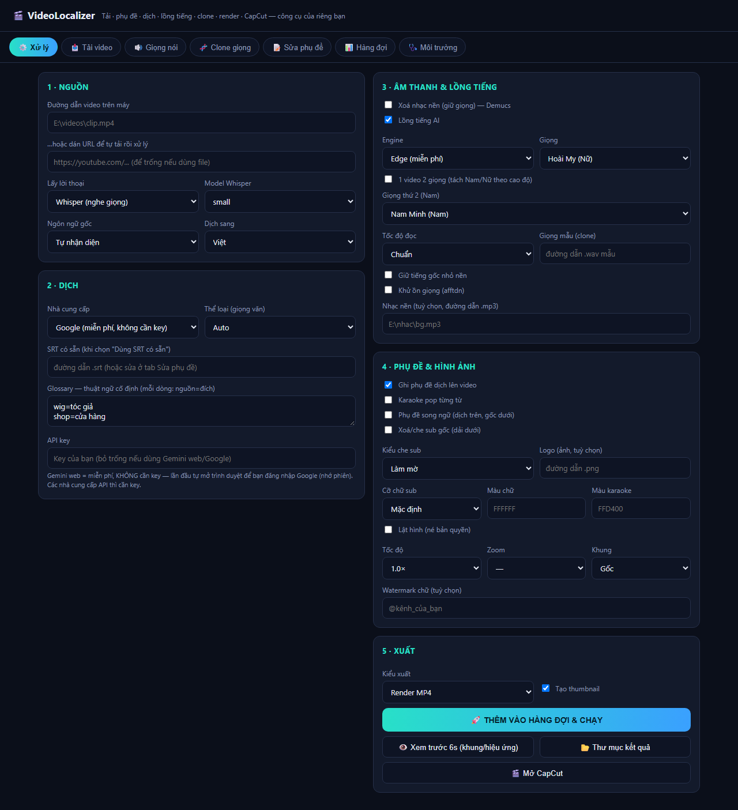
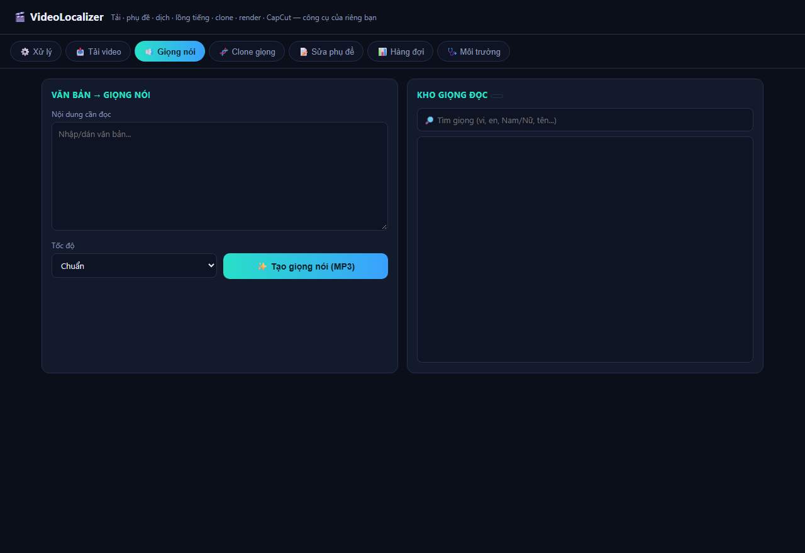
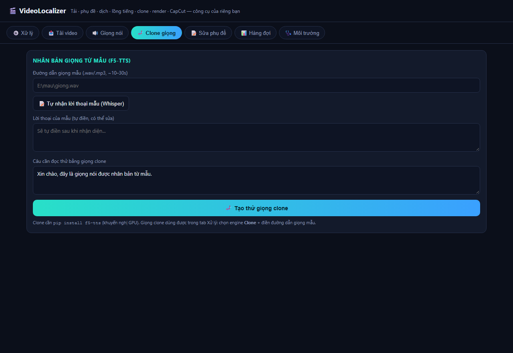
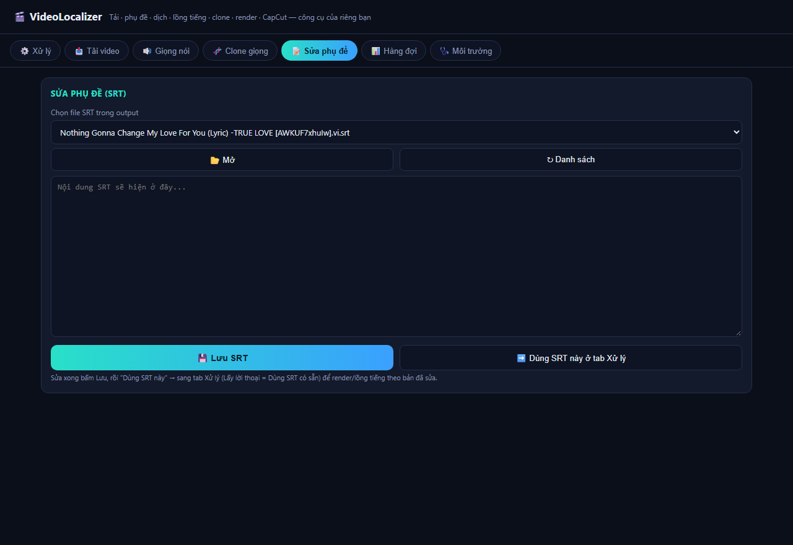
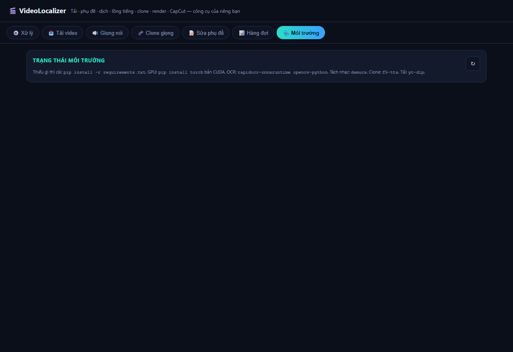

# VideoLocalizer


-28e0c8)


Công cụ **của riêng bạn** để bản địa hóa video hàng loạt — tải, nhận phụ đề, dịch, lồng tiếng và render,
viết mới 100% từ thành phần mã nguồn mở. Bạn sở hữu toàn bộ mã, dùng vĩnh viễn, không license.

## Ảnh giao diện
Màn hình xử lý chính (tải · phụ đề · dịch · lồng tiếng · hình ảnh · xuất):



| Giọng nói (Voice Studio) | Clone giọng | Sửa phụ đề | Môi trường |
|---|---|---|---|
|  |  |  |  |

## Tính năng
- 📥 **Tải video** (yt-dlp): YouTube/TikTok/Instagram/X/Reddit/Facebook…
- 📝 **Lấy lời thoại**: Whisper (nghe giọng) hoặc **OCR** chữ cứng (RapidOCR) + **xoá/làm mờ sub gốc**
- 🌐 **Dịch**: Gemini / Groq / OpenAI (theo thể loại: review/hội thoại/cổ trang/tin tức/hài…)
- 🎧 **Tách nhạc nền** giữ giọng (Demucs)
- 🎙️ **Lồng tiếng AI**: Edge-TTS (miễn phí), Piper (offline), **Clone giọng** (F5-TTS) từ mẫu
- 📄 **Phụ đề**: burn, style, **karaoke pop từng từ** (ASS)
- 🎬 **Hình ảnh**: lật, tốc độ, zoom, **đổi khung** 9:16/1:1/16:9, watermark, thumbnail
- 📤 **Xuất**: Render MP4 **hoặc** draft **CapCut** (hoặc cả hai)
- 📊 **Hàng đợi batch**: xử lý nhiều video liên tiếp

## Cài đặt từ Git (máy mới)
```bat
git clone <repo-url> VideoLocalizer
cd VideoLocalizer
python -m venv .venv
.venv\Scripts\python -m pip install -r requirements.txt
.venv\Scripts\python scripts\download_models.py      REM tải model Piper tiếng Việt (offline)
REM (tuỳ chọn) dịch Gemini web: .venv\Scripts\python -m playwright install chromium
run.bat                                              REM chạy (hoặc build exe bên dưới)
```
Đóng gói thành app có cửa sổ riêng (`VideoLocalizer.exe`):
```bat
.venv\Scripts\python -m pip install pywebview pyinstaller
.venv\Scripts\python -m PyInstaller --onefile --noconsole --name VideoLocalizer --collect-all webview desktop.py
copy dist\VideoLocalizer.exe .\VideoLocalizer.exe
```
> `.venv`, model, `dist/`, `output/` không nằm trong repo (xem `.gitignore`) — tái tạo bằng các lệnh trên.

## Cài đặt
```bat
cd /d "E:\AutoSub\VideoLocalizer"
python -m venv .venv
.venv\Scripts\python -m pip install -r requirements.txt
```
Muốn đủ tính năng, cài thêm tuỳ nhu cầu:
```bat
.venv\Scripts\python -m pip install yt-dlp rapidocr-onnxruntime opencv-python demucs f5-tts
.venv\Scripts\python -m pip install torch --index-url https://download.pytorch.org/whl/cu121   REM GPU
```
> `ffmpeg` bắt buộc — máy đã có sẵn trong CFlow (`...\vendor\ffmpeg`), tool tự dò dùng lại.

## Chạy
```bat
run.bat
```
Mở `http://127.0.0.1:8899/`. Tab **Môi trường** cho biết còn thiếu gói nào.

## Cấu trúc mã
```
VideoLocalizer/
  server.py            # web server + REST API (stdlib, cổng 8899)
  web/index.html       # giao diện 4 tab
  core/
    tools.py           # dò ffmpeg, chạy lệnh, probe media
    download.py        # yt-dlp
    asr.py             # Whisper (faster-whisper)
    ocr.py             # OCR hardsub + filter xoá dải sub cũ
    translate.py       # Gemini/Groq/OpenAI (REST)
    separate.py        # Demucs tách nhạc/giọng
    tts.py             # edge/piper/clone + căn timestamp
    subtitle.py        # SRT/ASS, karaoke
    video.py           # reframe, watermark, thumbnail
    render.py          # ffmpeg render cuối
    capcut.py          # sinh draft CapCut
    pipeline.py        # điều phối 1 video
    queue.py           # hàng đợi batch
  downloads/  output/  work/    # dữ liệu chạy
```

## Luồng
```
(URL→tải) → Whisper|OCR → (Demucs) → dịch → lồng tiếng/clone → burn phụ đề/karaoke
          → lật/zoom/đổi khung/watermark → Render MP4 và/hoặc Draft CapCut → thumbnail
```

## Giấy phép thành phần
faster-whisper (MIT) · edge-tts (GPL-3.0) · yt-dlp (Unlicense) · RapidOCR (Apache-2.0) ·
Demucs (MIT) · F5-TTS (MIT/CC) · Piper (MIT) · ffmpeg (LGPL/GPL) · pywebview (BSD).

## License
Mã nguồn trong repo này do tác giả viết, phát hành theo **MIT License** — xem [LICENSE](LICENSE).
Khi phân phối kèm các thành phần bên thứ ba ở trên, hãy tuân thủ giấy phép riêng của từng thành phần.
